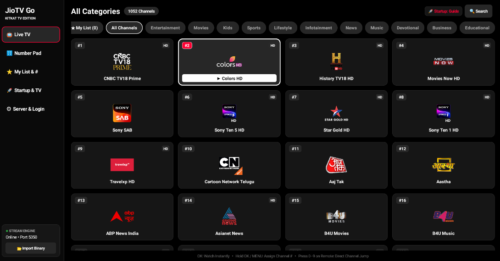

<div align="center">
  <h1>📺 JioTV Go — KitKat TV Edition</h1>
  <p><strong>Streamlined, ultra-lightweight JioTV client built specifically for older Android TVs (Android 4.4 KitKat+) with full TV Remote Navigation support!</strong></p>

  <p>
    
    
    
    <a href="LICENSE"></a>
  </p>

  <p>
    Developed by <a href="https://github.com/Hacker5Cloud"><strong>Hacker5Cloud</strong></a> • Forked from <a href="https://github.com/JioTV-Go/jiotv_go_app">JioTV-Go</a>
  </p>
</div>

---

## 📸 Screenshot

<p align="center">
  
</p>

---

## ✨ Why This Edition? (Built for Older TVs)

Many older Smart TVs, Android TV boxes, and Fire TV sticks running legacy Android versions (such as **Android 4.4 KitKat** through Android 7) struggle with modern, heavy frameworks or outdated SSL certificates. This edition is engineered from the ground up to breathe new life into older television hardware:

* 📺 **Legacy Android TV Ready (API 19+):** Strictly optimized for **Android 4.4 KitKat and above**, replacing heavy UI toolkits with a blazing-fast native Android view hierarchy that runs smoothly on low-RAM TVs (512 MB – 1 GB RAM).
* 🔐 **Modern TLS 1.2 / Certificate Support on Old TVs:** Built-in Conscrypt TLS 1.2 support and custom CA bundle bridge so older TVs never fail with SSL/HTTPS handshake errors.
* ⚡ **Low-Latency Hardware Playback:** Uses a zero-copy hardware `SurfaceView` player with fast HLS/DASH startup buffering and adaptive bitrate streaming.
* 🚀 **Auto-Start & Direct Channel Boot:** Configure the app to automatically start the stream engine and launch directly into your favorite TV channel or the TV Guide on boot.

---

## 🎮 Full TV Remote & Navigation Button Support

Designed around a true **10-foot TV experience**, every screen and action can be controlled effortlessly using a standard **TV Remote (D-Pad + Number Keys)**:

### 🧭 In the TV Guide & Menus
| Remote Button | Action |
| :--- | :--- |
| **D-Pad (Up / Down / Left / Right)** | Navigate smoothly between the Left Sidebar Rail, Category Pills, and Channel Grid with high-contrast focus borders |
| **OK / Center (D-Pad Center / Enter)** | Watch the selected channel instantly |
| **Long-Press OK** or **MENU Button** | Open the quick modal to **Assign a Custom Channel Number** or add/remove from **My List** |
| **0 – 9 Number Keys** | **Direct Channel Jump** from anywhere in the app — just type the channel number on your remote! |
| **BACK Button** | Return to the sidebar rail or exit overlays cleanly |

### 🎬 Inside the Video Player
| Remote Button | Action |
| :--- | :--- |
| **D-Pad UP / DOWN** (or **CH+ / CH-**) | Instant **Channel Zapping** (switches to the next/previous channel without leaving the player) |
| **D-Pad LEFT** | Slide out the **Quick Channel Drawer** to browse and switch channels while watching |
| **D-Pad RIGHT** or **OK / Enter** | Toggle the **Bottom Player HUD** (Quality selector, Channel Number assignment, On-screen Numpad, Aspect Ratio) |
| **0 – 9 Number Keys** | Type any channel number on your remote with live On-Screen Display (OSD) preview to jump directly to that channel |
| **BACK Button** | Close active player overlays/drawer, or return to the Live TV Guide |

---

## 🖥️ Interface Overview

* **📺 Live TV:** Clean TV Remote Channel Grid with Category Filter Pills (`All Channels`, `Entertainment`, `Movies`, `Sports`, `News`, etc.) and `★ My List`.
* **🔢 Number Pad:** On-screen dialer and speed-dial directory for remotes without dedicated physical number buttons.
* **⭐ My List & #:** Custom Channel Lineup & Number Studio — organize your favorite channels and assign custom dial numbers (e.g., `#1`, `#2`, `#101`).
* **🚀 Startup & TV:** Configure startup behavior, default video quality, and preferred audio/channel languages.
* **⚙️ Server & Login:** Easy JioTV OTP login, local stream engine status, port settings, and binary management.

---

## 🛠️ Building from Source

1. Clone this repository:
   ```bash
   git clone https://github.com/Hacker5Cloud/jiotv_go_app.git
   cd jiotv_go_app
   ```
2. Build the APK using Gradle:
   ```bash
   ./gradlew assembleRelease
   ```

---

## 🤝 Credits & Acknowledgements

* **Developed & Maintained (KitKat TV Edition):** [Hacker5Cloud](https://github.com/Hacker5Cloud)
* **Original Project (Upstream):** Forked from [JioTV-Go/jiotv_go_app](https://github.com/JioTV-Go/jiotv_go_app) and powered by the [JioTV Go](https://github.com/JioTV-Go/jiotv_go) project.

---

## 📄 License

This project remains completely **open source** under the **[MIT License](LICENSE)**, preserving the original MIT license from the upstream authors.

* **Copyright (c) 2026 Hacker5Cloud**
* **Copyright (c) 2025 JioTV-Go Team (https://github.com/JioTV-Go)**

See the [LICENSE](LICENSE) file for the full license text.
